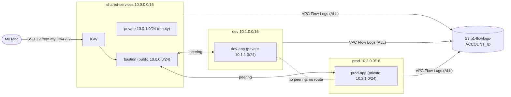

# Segmented Multi-VPC Network on AWS (Terraform)

Three isolated AWS VPCs built entirely from Terraform: a **shared-services** VPC with the only SSH entry point (a bastion), and separate **dev** and **prod** VPCs that can each talk to shared-services but **not to each other**. Security groups, NACLs and VPC Flow Logs enforce and prove the segmentation. Small test instances demonstrate what is allowed and what is blocked.

## The problem it solves

Dev and prod workloads should be isolated so a mistake or compromise in dev cannot reach prod, yet both need a controlled way in for administration. This project shows a minimal, low-cost hub-and-spoke layout: one hub (shared-services) with spokes (dev, prod) that are deliberately not connected to each other, with every blocked or allowed flow verifiable.

## Architecture



A draw.io version can be added to `docs/`.

### IP plan

| VPC | CIDR | Public subnet | Private subnet | Instances |
|---|---|---|---|---|
| shared-services | 10.0.0.0/16 | 10.0.0.0/24 | 10.0.1.0/24 | bastion (public IPv4) |
| dev | 10.1.0.0/16 | 10.1.0.0/24 | 10.1.1.0/24 | dev-app (private only) |
| prod | 10.2.0.0/16 | 10.2.0.0/24 | 10.2.1.0/24 | prod-app (private only) |

All in `ap-southeast-2` (Sydney), AZ `ap-southeast-2a`. Peering: shared↔dev and shared↔prod only. Peering is non-transitive, so dev cannot reach prod through shared.

### Controls

- **Route tables:** private route tables have only the local route plus the peering route to shared. No internet route (no NAT).
- **Security groups:** bastion SSH only from my IPv4 /32; dev/prod workloads accept SSH and ICMP only from 10.0.0.0/16. Nothing allows inbound `0.0.0.0/0`.
- **NACLs** (dev/prod private subnets, stateless): allow TCP 22, ICMP and ephemeral return ports (1024-65535) from/to 10.0.0.0/16, deny everything else.
- **Flow logs:** one per VPC, ALL traffic, 60 s aggregation, to an encrypted, non-public S3 bucket with a 30-day lifecycle. The bucket lives in a separate Terraform stack so it survives teardown.

## Repository layout

```
logging/   separate stack (own state): S3 flow log bucket. Not destroyed with the network.
network/   main stack: 3 VPCs, peering, SGs, NACLs, flow logs, instances.
modules/vpc/  reusable VPC module (VPC, 2 subnets, IGW, route tables).
tests/     check_network.sh, connectivity.sh, check_flowlogs.sh
docs/      test output and evidence (add diagram and screenshots here)
```

## Deploy

Prerequisites: Terraform >= 1.5, AWS CLI with credentials for an IAM user, an SSH key pair at `~/.ssh/project1` / `project1.pub`.

```bash
# 1. logging stack (once; keeps the bucket)
cd logging && terraform init && terraform apply

# 2. network stack. Pass your IPv4 as curl/ssh see it (see "What broke" #3 for why).
cd ../network && terraform init
export TF_VAR_my_ip_override="$(curl -4 -s https://checkip.amazonaws.com)/32"
terraform plan -out=tfplan && terraform apply tfplan

# 3. tests
cd .. && tests/check_network.sh
tests/connectivity.sh | tee docs/connectivity-results.txt
tests/check_flowlogs.sh | tee docs/flowlog-evidence.txt   # waits for logs (5-10 min)
```

If SSH to the bastion times out, your public IPv4 has probably changed: re-run the `export` above and `terraform apply` again.

## Destroy

```bash
cd network && terraform destroy     # removes VPCs, instances, peering, etc.
# logging/ is intentionally left alone so the flow logs survive
```

## Test matrix and results

`tests/connectivity.sh` (full output in `docs/connectivity-results.txt`): **8/8 PASS**.

| # | From | To | Expected | Result |
|---|---|---|---|---|
| 1 | My Mac | Bastion SSH | Works | PASS |
| 2 | My Mac | dev-app directly | Fails (no public IP) | PASS |
| 3 | Bastion | dev-app ping + SSH | Works | PASS |
| 4 | Bastion | prod-app ping + SSH | Works | PASS |
| 5 | dev-app | prod-app ping + TCP 22 | Fails (no route) | PASS |
| 6 | prod-app | dev-app ping + TCP 22 | Fails (no route) | PASS |
| 7 | dev-app | internet | Fails (no NAT) | PASS |
| 8 | Bastion | prod-app TCP 3306 | Fails (SG/NACL, logged REJECT) | PASS |

`tests/check_network.sh` verifies the AWS side with the CLI: VPC CIDRs, subnets, route tables, active peerings, no dev↔prod route, security group sources, NACL rules.

## Flow log evidence

Found by `tests/check_flowlogs.sh` (full output in `docs/flowlog-evidence.txt`): **PASS**. 210 records in total, 60 ACCEPT and 150 REJECT (the extra REJECTs are mostly internet background noise hitting the bastion's public IP).

Test 8, bastion to prod-app on TCP 3306, recorded as a REJECT at prod-app's network interface:

```
2 228998979209 eni-0f06f66a88e5bf24a 10.0.0.83 10.2.1.48 43348 3306 6 5 300 1792494096 1792494123 REJECT OK
```

| Field | Value | Meaning |
|---|---|---|
| version | 2 | flow log format version |
| account-id | 228998979209 | owner of the interface |
| interface-id | eni-0f06...24a | the prod-app network interface that saw the packets |
| srcaddr | 10.0.0.83 | the bastion (across the peering) |
| dstaddr | 10.2.1.48 | prod-app |
| srcport | 43348 | random ephemeral port chosen by the bastion |
| dstport | 3306 | MySQL port the bastion tried |
| protocol | 6 | TCP |
| packets / bytes | 5 / 300 | 5 SYN packets (the initial one plus retries) |
| start / end | 1792494096 / 1792494123 | Unix timestamps of the 27 s window |
| action | REJECT | dropped by the NACL (and the SG has no 3306 rule either) |
| log-status | OK | record is complete |

Matching ACCEPT for SSH from the bastion to dev-app and prod-app:

```
2 228998979209 eni-06d8897ac7d8ddb60 10.0.0.83 10.1.1.192 40522 22 6 5 268 1792494033 1792494062 ACCEPT OK
2 228998979209 eni-0f06f66a88e5bf24a 10.0.0.83 10.2.1.48 37820 22 6 5 268 1792494068 1792494069 ACCEPT OK
```


## What broke and how I fixed it

1. **Region blocked by an Organization policy.** In `us-east-1` every EC2/VPC/SSM call failed with "explicit deny in a service control policy". Decoding the error showed a statement `UsEast1Partitional` that denies everything in us-east-1 except global services. Fix: moved the whole project to `ap-southeast-2` (Sydney), where dry-run `create-vpc` and `run-instances` succeed.
2. **Inline route vs `aws_route` conflict.** The public route tables had the internet route as an inline `route {}` block while peering routes were separate `aws_route` resources. Terraform treats inline routes as the full list, so the next plan wanted to delete the peering routes. Caught when Phase 5's plan showed 3 unexpected route table changes. Fix: moved the internet route to its own `aws_route`, adopted the existing routes with temporary `import` blocks, re-planned to "No changes".
3. **SSH to the bastion timed out: wrong source IP.** On my Jio mobile connection, Terraform's `http` data source and `curl`/`ssh` reach the internet with different public IPv4 addresses (carrier NAT), so the security group allowed the wrong one. Fix: apply with `TF_VAR_my_ip_override="$(curl -4 -s https://checkip.amazonaws.com)/32"`.
4. **Connectivity tests 3-7 failed with "Connection timed out during banner exchange".** Not a network block: SSH setup from my mobile link to Sydney takes about 10 s through a jump, and the script's 5 s connect timeout was too short. Fix: ConnectTimeout 30 s for SSH setup; the probes still time out after 5 s.
5. **`terraform console` printed `(known after apply)` for the IP.** Data sources are not in state until an apply. Fix: expose the value as an output so `plan` shows it.
6. **"Module not installed" after adding module calls.** Fix: run `terraform init` whenever a module call is added.


## Cost notes

- Free to hold: VPCs, subnets, route tables, IGWs, same-region peering, security groups, NACLs, flow log configuration.
- Billed only while running: 3 x `t3.micro` (about $0.013/h each), one public IPv4 on the bastion (about $0.005/h), three 8 GB gp3 volumes. Roughly $0.05/h in total; the stack was up for well under an hour of testing, then destroyed.
- Explicitly avoided: NAT Gateway, Transit Gateway, VPN Gateway, Elastic IPs, interface VPC endpoints.
- The logging bucket stores kilobytes of logs and expires them after 30 days.

## When to swap peering for Transit Gateway

Peering is cheap, simple and has no bandwidth bottleneck, which is right for three VPCs in a hub-and-spoke. Move to Transit Gateway when:

- the number of VPCs grows and a full mesh (n(n-1)/2 peerings and routes) becomes unmanageable;
- you need **transitive** routing (spoke to spoke through a central hub, shared inspection, centralized egress);
- you need to attach VPNs or Direct Connect once and share them with many VPCs;
- you want route-table-based segmentation per attachment rather than per-peering routes.

The trade-off is cost: a Transit Gateway bills per attachment-hour plus per GB processed, whereas same-region peering has no hourly charge.
